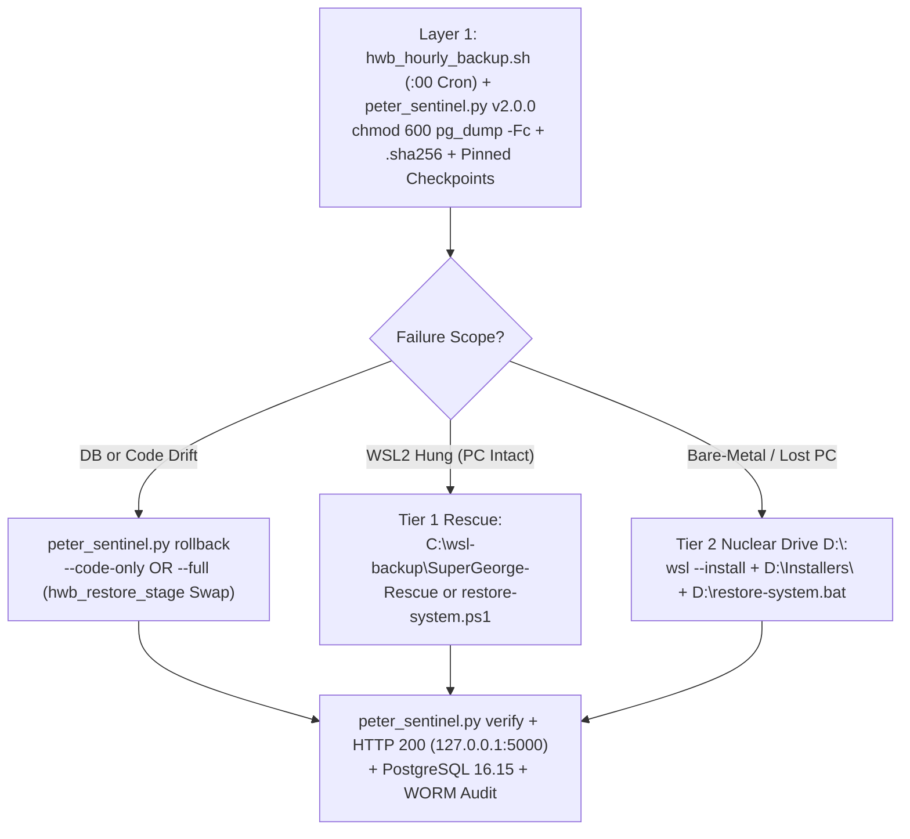

| **Document Control** | |
| :--- | :--- |
| **Document Title** | **Disaster Recovery and Data Restoration SOP** |
| **Document ID** | HWB-QMS-9.3 |
| **Version** | 4.5.0 (Architecture v3.1.0) |
| **Status** | APPROVED |
| **Author** | Peter (Recovery Specialist) & George (Systems Architect) |
| **Approved By** | Humberto Dominguez, CEO |
| **Date** | 11/12/2026 |
| **ISO 9001 Clause** | 7.1.3 (Infrastructure) & ISO/IEC 27001 A.12.1 |

---

# Standard Operating Procedure: **Disaster Recovery and Data Restoration SOP**

## 1.0 Purpose
This procedure defines the protocol for recovering HWB Cleaning Services LLC databases, application containers, environment secrets, and AI agent memory following a workstation freeze, data corruption event, or complete computer loss.

## 2.0 Scope
Applies to the WSL2 Ubuntu Linux workspace (`/home/humbertoed/gemini_projects`), Docker containers (`hwb_web_app`, `hwb_agent_worker`, `hwb_postgres_dev`), PostgreSQL 16.15 databases, Windows rescue tools (`C:\wsl-backup\SuperGeorge-Rescue`), and the Grab-and-Go USB Recovery Drive (`D:\`).

## 3.0 Retired Legacy Mechanisms (`BUG-173` / `SO-SCAR-023`)
* **Retired Daemon:** `sigma-peter.service` (`15-minute` systemd loop) is permanently disabled and retired.
* **Prohibited Backup Path:** `/mnt/c/.../OneDrive` cross-OS `9P` filesystem synchronization is permanently prohibited because `9P` file locking stalls WSL2 I/O and hangs local containers. All active runtime backups write strictly to native Linux `ext4` or explicit offline Windows/USB archives.

## 4.0 The 3-Layer Sovereign Backup & Two-Tier Recovery Architecture (`v3.1.0`)

### 4.1 Layer 1: Hardened Hourly Native `ext4` Snapshots & Peter Checkpoints (`v2.0.0`)
* **Hardened Hourly Binary Database Snapshots (`chmod 600` + `.sha256`):** `scripts/hwb_hourly_backup.sh` executes via Linux `cron` at `:00` every hour, writing 24-hour rolling `pg_dump -Fc` custom-format PostgreSQL 16.15 snapshots locked to `chmod 600` alongside `.sha256` checksum files (`hwb_dev_db.dump.sha256`) in `backups/hourly/` and `backups/latest/`.
* **Unified Peter 3-Command Local Recovery Standard (`scripts/peter_sentinel.py v2.0.0`):** Strictly scoped to `/home/humbertoed/gemini_projects` (paired with Azure `sigmajan-server` 35-day PITR in cloud production):
  1. `python3 scripts/peter_sentinel.py checkpoint --label <name>` — Pins `chmod 600` PG16 `pg_dump -Fc`, `chmod 600` `.env`, and active HWB code/QMS archive (`hwb_code_bundle.tar.gz`) in `backups/checkpoints/<name>/` with `SHA256SUMS.txt` (exempt from 24h auto-purge) and test-restores into temporary database `hwb_peter_verify_tmp` (`80+` public tables verified, then dropped).
  2. `python3 scripts/peter_sentinel.py rollback --label <name> [--code-only | --full]` — `--code-only` restores code/QMS and restarts `hwb_web_app`; `--full` restores the pinned PG16 dump into clean staging DB `hwb_restore_stage` first, stops `hwb_web_app` and `hwb_agent_worker` briefly, swaps `hwb_dev_db` cleanly without open-socket or `"SecurityAuditLogs"` WORM conflicts, restarts containers, and verifies all 4 worker processes via `docker top`.
  3. `python3 scripts/peter_sentinel.py verify` — Verifies `backups/latest/hwb_dev_db.dump` is `< 90` minutes old, non-empty, `chmod 600`, and passes SHA-256 verification, recording status in PostgreSQL `"AIEmployeeHeartbeat"` and `"SecurityAuditLogs"`.

### 4.2 Tier 1 Rescue (PC Intact, WSL2 / Ubuntu Hung or Broken)
When the Windows 11 host PC is healthy but WSL2/Ubuntu is unresponsive or broken:
1. **Out-of-Band Windows Antigravity Rescue Cockpit:** Open Windows Antigravity directly on `C:\wsl-backup\SuperGeorge-Rescue` (configured in `Request Review` / `ASK` mode with zero `L:\` Linux drive dependency so Windows UI never freezes when WSL2 is hung).
2. **Automated Host Recovery Script:** Alternatively, run `C:\wsl-backup\restore-system.ps1` in an elevated PowerShell window to reset the WSL2 compute service and restart the local Docker fleet.

### 4.3 Tier 2 Bare-Metal / Lost PC Nuclear Restore (Grab-and-Go USB Drive `D:\`)
In the event of total computer loss, theft, fire, or catastrophic weather replacement on a brand-new Windows 11 machine:
1. **Initialize WSL2:** Open Administrator PowerShell, run `wsl --install -d Ubuntu`, and reboot Windows.
2. **Install Offline Host Prerequisites (`D:\Installers\`):**
   * Run `D:\Installers\Docker Desktop Installer.exe` (sign in with Docker Hub User `hdominguez11`, Email `hdominguez@hwbcleaning.com`; after Step 3, enable `Settings -> Resources -> WSL Integration -> Ubuntu` and keep `"UseResourceSaver": false` / `"AutoPauseTimeoutSeconds": 0` in `%APPDATA%\Docker\settings-store.json`).
   * Run `D:\Installers\Antigravity-x64.exe` (sign in with Google account `humbertoed@gmail.com`).
3. **Execute 1-Click Full System Import:** Double-click `D:\restore-system.bat` (Run as Administrator). This imports the full Ubuntu WSL2 image from `D:\2026-data-backup-ubuntu\ubuntu-full.tar`, applies `.wslconfig` (`12GB` RAM / `6` CPUs), and verifies `/home/humbertoed/gemini_projects`, `/home/humbertoed/babysop/special-ops`, sibling sovereign workspaces, and `supergeorge_brain.db`.
4. **Boot Local Fleet:** Open Windows Antigravity -> `File -> Open Folder -> D:\SuperGeorge-Rescue` (or connect directly to WSL `Ubuntu` once restored) and start the local container fleet (`127.0.0.1:5000`, `:5100`, `:8090`).

## 5.0 Emergency Working-Tree & Database Commands
* **Full Staging-Swap Rollback (`peter_sentinel.py v2.0.0`):**
  `python3 scripts/peter_sentinel.py rollback --label <name> --full`
* **Code-Only Rollback (`peter_sentinel.py v2.0.0`):**
  `python3 scripts/peter_sentinel.py rollback --label <name> --code-only`
* **Hourly Backup & Checksum Verification:**
  `python3 scripts/peter_sentinel.py verify`

## 6.0 Verification (Zero-Defect Check)
* `python3 scripts/peter_sentinel.py verify` passes (`< 90m`, `chmod 600`, SHA-256 verified, logged to `"AIEmployeeHeartbeat"` / `"SecurityAuditLogs"`).
* Local web application responds with `HTTP 200` at `http://127.0.0.1:5000/heartbeat` and `docker top hwb_agent_worker` shows all 4 worker processes active.
* `hwb_postgres_dev` (`PostgreSQL 16.15`) reports active lead and audit tables intact with `SecurityAuditLogs` WORM trigger active.
* Regression and security suites (`scripts/test_web_performance_rack_14.py` and `scripts/check_soc2_data_leakage.py`) pass at 100%.

## 7.0 Process Flow Chart

## 8.0 Revision History
| Version | Date | Author | Change Description |
| :--- | :--- | :--- | :--- |
| 4.5.0 | 11/12/2026 | Peter & George | Standardized `scripts/peter_sentinel.py v2.0.0` (`checkpoint`, `rollback [--code-only \| --full]` via `hwb_restore_stage`, and `verify`) and hardened `scripts/hwb_hourly_backup.sh` with `chmod 600` and `.sha256` checksums. Approved by Humberto Dominguez, CEO. |
| 4.4.0 | 11/12/2026 | Peter & George | Codified 3-Layer Sovereign Backup & Two-Tier Recovery Architecture (`v3.0.0`): retired `sigma-peter.service` (`15m`) and `/mnt/c/.../OneDrive` `9P` sync (`BUG-173` / `SO-SCAR-023`), documented `scripts/hwb_hourly_backup.sh` (`:00` cron native `ext4`), Tier 1 Windows Rescue Cockpit (`C:\wsl-backup\SuperGeorge-Rescue`), and Tier 2 Bare-Metal Nuclear Restore (`D:\Installers\` + `D:\restore-system.bat`). Approved by Humberto Dominguez, CEO. |
| 4.3.0 | 10/17/2026 | Peter & George | Upgraded for PostgreSQL 16.15 across Azure (`sigmajan-server`) and Local Docker (`hwb_postgres_dev`). |
| 2.0.0 | 05/21/2026 | George | Added Peter physical restoration and Tier 6 telemetry rules. |
| 1.0.0 | 03/02/2026 | Gemini | Initial Release. |
