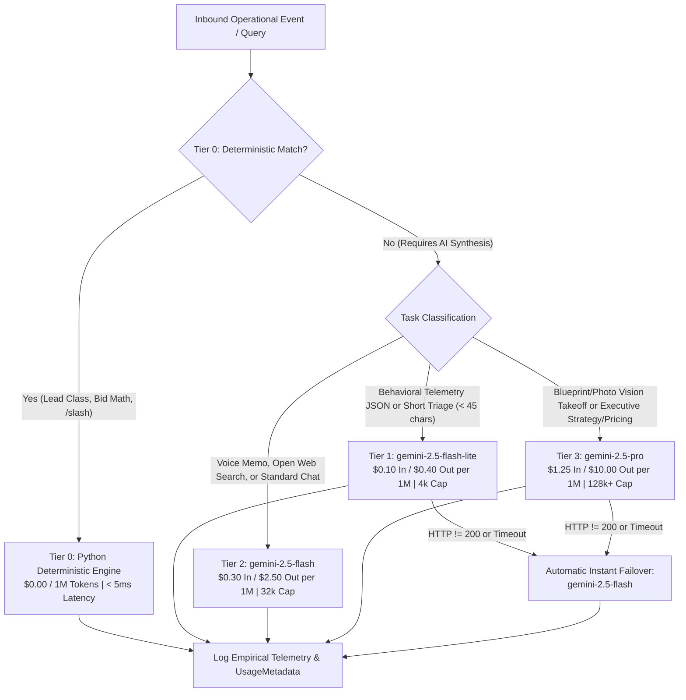

# HWB-QMS-11.11 Four-Tier AI Model Routing and FinOps Standard

| **Standard Field** | **Institutional Detail** |
| :--- | :--- |
| **Document ID** | HWB-QMS-11.11 |
| **Document Name** | Four-Tier AI Model Routing and FinOps Standard |
| **Governance Standard** | ISO 9001:2026 Clause 7.1.3 (Infrastructure), ISO/IEC 42001:2023 (AIMS), Mandate 1 (Zero Synthetic Data), Mandate 2 (Procedure-First), Mandate 5 (Minimization Mandate), & Mandate 6 (Industrial Hardening) |
| **Approving Authority** | Humberto Dominguez (Chief Executive Officer) |
| **Fiscal Authority** | Maria Bolanos (Vice President of Finance) |
| **Systems Architect** | George (Lead Systems Architect & Senior ISO 9001 Auditor) |
| **Effective Date** | 10/18/2026 |
| **Classification** | Level 2 Standard Operating Procedure & FinOps Architecture Standard |

---

## 1.0 Purpose & Strategic Intent
This Standard Operating Procedure (SOP) establishes the deterministic and multi-model AI routing architecture (`HWB-QMS-11.11`) for HWB Cleaning Services LLC ("HWB"). To protect operating margins under Maria Bolanos's fiscal oversight while delivering maximum analytical intelligence for commercial construction takeoffs and executive strategy, all inbound requests across the HWB Telegram Command Center (`scripts/telegram_listener.py`), Behavioral Insight Engine (`scripts/telegram_behavioral_engine.py`), and CRM Backoffice are routed across a strict **4-Tier AI Model Routing & FinOps Matrix**.

---

## 2.0 Four-Tier AI Model Routing & FinOps Matrix

### 2.1 Tier Specifications & Token FinOps Governance

| **Tier** | **Model / Engine** | **Input Cost (1M)** | **Output Cost (1M)** | **Context Cap** | **Assigned Operational Workloads** | **Failover Target** |
| :--- | :--- | :--- | :--- | :--- | :--- | :--- |
| **Tier 0** | Deterministic Python (`classifier.py`, `estimator.py`, Slash Router) | `$0.00` | `$0.00` | Unlimited | 9-rule lead classification across `25,376` leads, deterministic commercial bid math, and Telegram `/slash` commands. | Native Exception Handler |
| **Tier 1** | `gemini-2.5-flash-lite` | `$0.10` | `$0.40` | `4,096` tokens | Behavioral telemetry JSON synthesis (`telegram_behavioral_engine.py`) and short conversational triage queries (`< 45` characters). | `gemini-2.5-flash` (Tier 2) |
| **Tier 2** | `gemini-2.5-flash` | `$0.30` | `$2.50` | `32,768` tokens | Multimodal voice memo transcription (`analyze_voice_with_gemini`), live grounded open web search (`search_open_web`), and standard operational chat. | Deterministic Fallback |
| **Tier 3** | `gemini-2.5-pro` | `$1.25` | `$10.00` | `128,000+` tokens | Construction blueprint, finish schedule, and jobsite photo vision takeoffs (`analyze_photo_with_gemini`) and complex executive strategy, pricing, margin, and contract queries (`analyze_text_with_gemini`). | `gemini-2.5-flash` (Tier 2) |

---

## 3.0 Routing Rules & Failover Protocol

### 3.1 Automated Model Selection (`route_hwb_gemini_model`)
1. **Vision & Blueprint Takeoffs (`BLUEPRINT_VISION`):** Any inbound jobsite photo, finish schedule, or construction drawing (`has_image=True`) routes directly to **Tier 3 (`gemini-2.5-pro`)** with automatic failover to **Tier 2 (`gemini-2.5-flash`)**.
2. **Executive Strategy & Pricing (`TEXT_REASONING` — High Complexity):** Any text query containing high-complexity financial, legal, or architectural keywords (`margin`, `pricing`, `contract`, `clause`, `liquidated`, `strategy`, `blueprint`, `takeoff`, `estimate`, `bid model`, `subcontractor rate`, `prevailing wage`, `collin college`, `horizon`, `architecture`, `audit`, `soc 2`, `iso 9001`), or detailed executive directives (`> 180` characters from an `Executive` or `Admin` role), routes to **Tier 3 (`gemini-2.5-pro`)** with failover to **Tier 2 (`gemini-2.5-flash`)**.
3. **Rapid Triage (`TEXT_REASONING` — Short Triage):** Short conversational check-ins (`< 45` characters without strategic/financial keywords or web-grounding triggers) route to **Tier 1 (`gemini-2.5-flash-lite`)** with failover to **Tier 2 (`gemini-2.5-flash`)**.
4. **Standard Operational Chat, Voice & Web Search (`VOICE_TRANSCRIPTION`, `OPEN_WEB_SEARCH`, `TEXT_REASONING`):** All voice memos, `/web` grounding queries, and general operational conversations route to **Tier 2 (`gemini-2.5-flash`)**.
5. **Behavioral Telemetry Synthesis (`BEHAVIORAL_SYNTHESIS`):** User interaction stream synthesis in `scripts/telegram_behavioral_engine.py` routes to **Tier 1 (`gemini-2.5-flash-lite`)** first and automatically falls back to **Tier 2 (`gemini-2.5-flash`)** if HTTP status != 200.

### 3.2 Zero-Downtime Failover & FinOps Telemetry (`post_gemini_with_failover` & `extract_hwb_gemini_usage`)
- Every API call extracts real `usageMetadata` (`promptTokenCount`, `candidatesTokenCount`, `totalTokenCount`) directly from the Gemini API response payload.
- Estimated token cost in USD (`estimated_cost_usd`) is calculated empirically using exact tier rates—zero synthetic estimates are permitted.
- If a primary model (`gemini-2.5-pro` or `gemini-2.5-flash-lite`) returns a non-200 HTTP code or experiences a network timeout, `post_gemini_with_failover` immediately retries the request against `gemini-2.5-flash` so field operators and executives never experience dropped commands.

---

## 4.0 Controlled Assets & Verification Gate (`SO-SCAR-009`)
1. **Primary Telegram Listener Daemon:** `/home/humbertoed/gemini_projects/scripts/telegram_listener.py`
2. **Behavioral Analytics Engine:** `/home/humbertoed/gemini_projects/scripts/telegram_behavioral_engine.py`
3. **Container Child-Process Inspection Gate (`SO-SCAR-009`):** Whenever `telegram_listener.py` is updated, the operator must verify container child processes via `docker top hwb_agent_worker` and `docker top hwb_web_app` to guarantee continuous 24/7 background process execution alongside HTTP 200 health on `http://127.0.0.1:5000`.

---
*End of Institutional SOP HWB-QMS-11.11*
