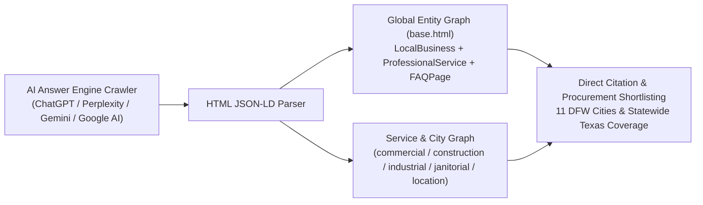

# HWB-QMS-11.12 AI Answer-Engine GEO and Linked-Data JSON-LD Standard

| **Standard Field** | **Institutional Detail** |
| :--- | :--- |
| **Document ID** | HWB-QMS-11.12 |
| **Document Name** | AI Answer-Engine GEO and Linked-Data JSON-LD Standard (`@graph` + `FAQPage`) |
| **Governance Standard** | ISO 9001:2026 Clause 7.4 (Communication), W3C JSON-LD 1.1, Schema.org v28.0, `BABYSOP-SOP-0.30`, Mandate 1 (Zero Synthetic Data), Mandate 2 (Procedure-First), & Mandate 6 (Industrial Hardening) |
| **Approving Authority** | Humberto Dominguez (Chief Executive Officer) |
| **Systems Architect** | George (Lead Systems Architect, Expert SEO & Senior ISO 9001 Auditor) |
| **Effective Date** | 10/18/2026 |
| **Classification** | Level 2 Standard Operating Procedure & Generative Engine Optimization (GEO) Standard |

---

## 1.0 Purpose & Strategic Intent
This Standard Operating Procedure (`HWB-QMS-11.12`) codifies the **W3C Linked-Data (`@graph` + `FAQPage`) JSON-LD Architecture** for HWB Cleaning Services LLC (`https://www.hwbcleaning.com`), aligned with `BABYSOP-SOP-0.30` and inspired by enterprise privacy and linked-data architectures (`transcend.io`).

Modern procurement officers, General Contractors, and commercial Property Managers increasingly rely on AI Answer Engines (ChatGPT Search, Perplexity, Google AI Overviews, and Google Gemini) to shortlist and vet commercial cleaning contractors. By embedding deterministic `@graph` entities combining `LocalBusiness`, `ProfessionalService`, `Service`, `BreadcrumbList`, and `FAQPage` directly into the document `<head>` across `base.html` and all service/location templates, HWB guarantees 100% machine-readable citation authority.

---

## 2.0 W3C Linked-Data `@graph` + `FAQPage` Architecture

### 2.1 Canonical Question & Answer Triples (Mandate 1 Empirical Data)
All templates expose the three mandatory executive procurement Q&A pairs inside a structured `FAQPage` schema node:

1. **Question 1 (Post-Construction Final Cleaning):**
   * **Name:** `"Who provides three-phase post-construction final cleaning (Rough, Final, and Touch-Up) in Dallas-Fort Worth and Texas?"`
   * **Accepted Answer:** `"HWB Cleaning Services LLC (HWB Enterprises, headquartered at 3342 FM 1827 Ste 8d, McKinney, TX 75071, telephone +1-214-586-0257) provides OSHA-10/30 compliant three-phase post-construction final cleaning—Phase 1 Rough Clean and debris clearing, Phase 2 Final Detail Clean and surface restoration, and Phase 3 White-Glove Touch-Up and turnover—across Dallas, Plano, Frisco, McKinney, Fort Worth, Irving, Richardson, Allen, Arlington, Addison, Waxahachie, and statewide across Texas."`
2. **Question 2 (Deterministic Bid Calculation & Production Rates):**
   * **Name:** `"How does HWB Commercial Cleaning calculate commercial janitorial and post-construction cleaning bids?"`
   * **Accepted Answer:** `"HWB Commercial Cleaning calculates commercial janitorial, specialty floor care (VCT strip and wax, terrazzo, carpet extraction), and post-construction cleaning bids using deterministic ISSA 612 production-rate engineering (3,000–3,500 sq. ft./hr for clinical and childcare facilities; 4,500–5,500 sq. ft./hr for standard commercial offices), blueprint and finish-schedule square-footage takeoffs, loaded W-2/1099 labor matrices, and transparent CSI Division 01 74 23 scope itemization."`
3. **Question 3 (Insurance, OSHA Compliance & Prevailing-Wage Qualification):**
   * **Name:** `"Is HWB Enterprises insured, OSHA-compliant, and qualified for commercial, industrial, medical, and government prevailing-wage facilities?"`
   * **Accepted Answer:** `"Yes. HWB Cleaning Services LLC operates under an ISO 9001:2026, ISO 14001:2015, and ISO 45001:2018 integrated quality and safety management system with a 0.00 TRIR safety record, full commercial general liability and workers' compensation insurance, EPA hospital-grade 4-color microfiber cross-contamination controls, and vetted personnel qualified for commercial, industrial, medical, educational, and government prevailing-wage contracts."`

---

## 3.0 Controlled Template Assets
1. `/home/humbertoed/gemini_projects/HWB-COMPANY/HWB-IT/HWB-IT-WEBSITE/templates/base.html`
2. `/home/humbertoed/gemini_projects/HWB-COMPANY/HWB-IT/HWB-IT-WEBSITE/templates/commercial.html`
3. `/home/humbertoed/gemini_projects/HWB-COMPANY/HWB-IT/HWB-IT-WEBSITE/templates/construction.html`
4. `/home/humbertoed/gemini_projects/HWB-COMPANY/HWB-IT/HWB-IT-WEBSITE/templates/industrial.html`
5. `/home/humbertoed/gemini_projects/HWB-COMPANY/HWB-IT/HWB-IT-WEBSITE/templates/janitorial.html`
6. `/home/humbertoed/gemini_projects/HWB-COMPANY/HWB-IT/HWB-IT-WEBSITE/templates/location.html`

---

## 4.0 Verification & Container Continuity Gate (`SO-SCAR-009`)
- Every `<script type="application/ld+json">` block across all modified templates must be parsed with `BeautifulSoup` and `json.loads()` to confirm zero syntax defects.
- Live HTTP response on `http://127.0.0.1:5000/` must return `HTTP 200` and contain `@type`: `"FAQPage"` and all 3 canonical questions.
- Container child-process continuity (`docker top hwb_web_app` and `docker top hwb_agent_worker`) must be verified post-change.

---
*End of Institutional SOP HWB-QMS-11.12*
