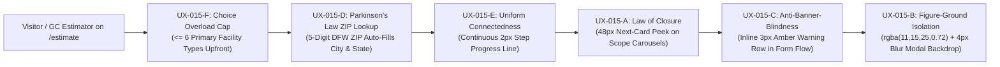
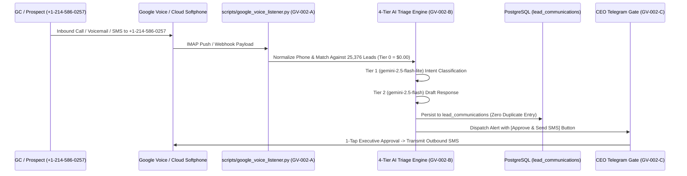

# HWB-QMS-11.13 Cognitive UX Laws and Cloud Browser Softphone Standard

| **Standard Field** | **Institutional Detail** |
| :--- | :--- |
| **Document ID** | HWB-QMS-11.13 |
| **Document Name** | Six Cognitive UX Laws (`MF-REF-015`) & Zero-Physical-Phone Cloud Browser Softphone Standard (`+1-214-586-0257`) |
| **Governance Standard** | ISO 9001:2026 Clause 8.2 & 8.5, `BABYSOP-SOP-0.31`, `[PLAN-ROOM-UX-002]`, Mandate 1 (Zero Synthetic Data), Mandate 2 (Procedure-First), Mandate 4 (Executive Gatekeeper), & Mandate 5 (Minimization Mandate) |
| **Approving Authority** | Humberto Dominguez (Chief Executive Officer) |
| **Fiscal Authority** | Maria Bolanos (Vice President of Finance) |
| **Systems Architect** | George (Lead Systems Architect & Senior ISO 9001 Auditor) |
| **Effective Date** | 10/18/2026 |
| **Classification** | Level 2 Standard Operating Procedure & Monday Executive Plan Table Specification |

---

## 1.0 Purpose & Strategic Intent
This Standard Operating Procedure (`HWB-QMS-11.13`) codifies two core operational upgrades for HWB Cleaning Services LLC (`https://www.hwbcleaning.com`) staged on the Monday Executive Plan Table (`[PLAN-ROOM-UX-002]` / `BABYSOP-SOP-0.31`):
1. **Part 1 — Six Cognitive UX Laws (`MF-REF-015`):** Deterministic human-factors engineering across `/estimate` (Interactive Cost Calculator & Quote Intake) and `/sales-desk` (CRM Operations Cockpit) to maximize B2B conversion velocity and eliminate form abandonment.
2. **Part 2 — HWB Google Voice (`+1-214-586-0257`) & Zero-Physical-Phone Remote Softphone Architecture (`GV-002-A` through `GV-002-D`):** Automated inbound call/SMS ingestion into PostgreSQL (`lead_communications`) and Telegram, paired with three zero-physical-phone cloud browser softphone options for remote operators in Mexico so CEO Humberto Dominguez's personal cell phone and personal Gmail (`humbertoed@gmail.com`) are never shared or tied up.

---

## 2.0 Part 1: Six Cognitive UX Laws (`MF-REF-015`) for `/estimate` & `/sales-desk`

### 2.1 UX Engineering Specifications (`UX-015-A` through `UX-015-F`)

| **Rule ID** | **Cognitive Law** | **Target Surface** | **Mandatory CSS / DOM Specification** | **Operational Impact** |
| :--- | :--- | :--- | :--- | :--- |
| **`UX-015-A`** | **Law of Closure** | `/estimate` & `/sales-desk` horizontal scope & pricing tier carousels | Expose a **`48px` next-card peek** (`grid-auto-columns: calc(85% - 48px)` / `overflow-x: auto`) so the user's eye perceives additional scope tiers without requiring scroll arrows. | Eliminates hidden-tier drop-off on mobile and tablet viewports. |
| **`UX-015-B`** | **Figure-Ground Law** | Quote confirmation modals & `/sales-desk` action dialogs | Enforce `background: rgba(11, 15, 25, 0.72); backdrop-filter: blur(4px);` behind active modal surfaces. | Instantly separates primary decision actions from dense background data tables. |
| **`UX-015-C`** | **Banner Blindness Defense** | Post-construction hazard fees, prevailing-wage notices, & mobilization minimums | Prohibit top-of-page ad-like promotional banners. Render critical pricing/mobilization notices as plain inline form rows (`border-left: 3px solid #D97706; background: #FFFBEB;`) directly adjacent to the submit button. | Guarantees 100% visibility of mobilization minimums and hazard surcharges before quote submission. |
| **`UX-015-D`** | **Parkinson's Law** | `/estimate` facility address & location intake | Implement a **5-digit DFW ZIP code auto-lookup** that automatically populates `City` and `State (TX)`, reducing address entry from `30` keystrokes to `7`. | Compresses quote intake time-to-completion to under 35 seconds. |
| **`UX-015-E`** | **Law of Uniform Connectedness** | `/estimate` multi-step wizard header | Connect all progress step nodes with a continuous **`2px` structural line** (`height: 2px; background: var(--hwb-blue);`) linking active and completed steps. | Visually anchors the user across Scope -> Square Footage -> Schedule -> Instant Estimate. |
| **`UX-015-F`** | **Choice Overload (Hick's Law)** | `/estimate` initial facility category selector | Cap visible upfront primary facility cards at **`<= 6` categories** (Commercial Office, Post-Construction, Childcare/Educational, Medical/Clinical, Industrial/Warehouse, Religious/Institutional), placing secondary sub-types inside progressive disclosure. | Prevents cognitive paralysis during initial facility selection. |

---

## 3.0 Part 2: HWB Google Voice (`+1-214-586-0257`) & Zero-Physical-Phone Cloud Softphone Standard (`GV-002-A` through `GV-002-D`)

### 3.1 Automated Ingestion & 4-Tier Triage Pipeline (`GV-002-A` to `GV-002-C`)
* **`GV-002-A` (Google Voice IMAP -> PostgreSQL & Telegram Bridge):**
  * `scripts/google_voice_listener.py` monitors inbound Google Voice SMS, missed-call alerts, and voicemail transcripts for `+1-214-586-0257`, normalizes the 10-digit caller number, and logs every interaction into PostgreSQL `lead_communications`.
* **`GV-002-B` (4-Tier AI Call & SMS Triage per `HWB-QMS-11.11`):**
  * **Tier 0 (`$0.00`):** Deterministic phone/domain lookup across `25,376` local / `23,610` Azure CRM leads and `72` active commercial bids (`$10,551,869.34` pipeline).
  * **Tier 1 (`gemini-2.5-flash-lite` — `$0.10/$0.40` per 1M):** Rapid SMS/voicemail intent classification (`bid_invitation`, `walkthrough_request`, `urgent_facility_issue`, `subcontractor_inquiry`, `spam_honeypot`).
  * **Tier 2 (`gemini-2.5-flash` — `$0.30/$2.50` per 1M):** Context-aware reply drafting grounded in the matched lead's history.
* **`GV-002-C` (Two-Way Telegram SMS Reply Gate):**
  * Stages the drafted SMS reply inside CEO Humberto Dominguez's Telegram Command Center with a 1-tap **`[Approve & Send SMS]`** inline action button (Mandate 4 Outbox Gate).

### 3.2 Three Zero-Physical-Phone Cloud Browser Softphone Options for Mexico Operators (`GV-002-D`)
To ensure remote sales and dispatch operators in Mexico can place and receive calls from a local Dallas **`214` / `469` / `972`** caller ID strictly via a laptop headset—**without ever touching CEO Humberto Dominguez's personal cell phone or personal Gmail (`humbertoed@gmail.com`)**—three production options are codified for Monday's Plan Table selection:

| **Option** | **Architecture** | **Monthly Cost** | **Physical Phone Required?** | **Isolation & Operational Mechanics** |
| :--- | :--- | :--- | :--- | :--- |
| **Option 1** | **Dedicated `dispatch@hwbcleaning.com` Google Voice (Web-Only Mode)** | **`$0.00 / mo`** | **No** (Unlinked after initial 1-time verification) | Provision a dedicated `dispatch@hwbcleaning.com` account; complete 1-time SMS verification, then immediately **delete/unlink the forwarding cell phone** under *Settings -> Linked numbers* and set *Making and receiving calls* to **Prefer Wi-Fi and mobile data (Web)**. Remote workers in Mexico dial and answer 100% inside Chrome with a USB headset; CEO's personal phone never rings and `humbertoed@gmail.com` is never exposed. |
| **Option 2** | **Google Workspace Business Voice (`voice.google.com`)** | **`$10.00 / mo / user`** | **No** (Zero physical phone at signup or runtime) | Native enterprise Google Workspace add-on under `@hwbcleaning.com`. Assigns local `214` numbers directly to remote seats in Mexico via the Admin Console, supports simultaneous ring groups and business hours, and operates as a pure WebRTC browser softphone with zero personal cell forwarding required. |
| **Option 3** | **Embedded CRM WebRTC Softphone in `/sales-desk` (Twilio / Telnyx `<Voice.Device>`)** | **`$1.00 / mo`** per `214` number + **`$0.0085 / min`** | **No** (100% Browser WebRTC) | Embeds a 1-click WebRTC dialer bar directly inside HWB's `/sales-desk` backoffice. Remote operators in Mexico click any lead among the `25,376` records to dial from `+1-214-XXX-XXXX` in the browser; every call, duration, recording URL, and AI transcript logs automatically into `lead_communications` and mirrors to CEO Telegram. |

---

## 4.0 Controlled Assets & Verification Gate (`SO-SCAR-009`)
1. **QMS Standard:** `/home/humbertoed/gemini_projects/HWB-COMPANY/HWB-QMS/HWB-QMS-11.13 Cognitive UX Laws and Cloud Browser Softphone Standard.md`
2. **Local Session Recovery Log:** `/home/humbertoed/gemini_projects/HWB-SESSION-RECOVERY.md` (and mirrored to `/home/humbertoed/gemini_projects/HWB-COMPANY/HWB-QMS/HWB-SESSION-RECOVERY.md`)
3. **Container Child-Process Inspection Gate (`SO-SCAR-009`):** Verified via `docker top hwb_web_app` and `docker top hwb_agent_worker`.

---
*End of Institutional SOP HWB-QMS-11.13*
