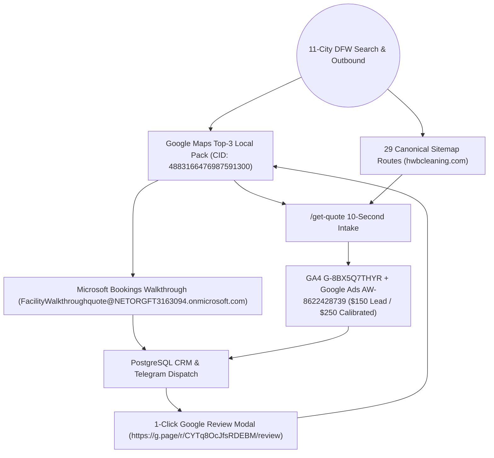

| **Document Control** |                                                                      |
| :------------------- | :------------------------------------------------------------------- |
| **Document Title**   | **Marketing Process, Google Local Map Pack & Conversion Attribution SOP** |
| **Document ID**      | HWB-QMS-8.0-MKT-001                                                 |
| **Version**          | 3.0.0                                                                |
| **Status**           | APPROVED                                                             |
| **Author**           | George (Systems Architect & Expert SEO)                              |
| **Approved By**      | Humberto Dominguez, CEO                                              |
| **Date**             | 10/16/2026                                                           |
| **ISO 9001 Clause**  | 8.1 & 8.2.1 — ISO 9001:2026 (ISO 9001:2015+Amd 1:2024)              |

---

# Standard Operating Procedure: **Marketing Process & Local Prominence Loop SOP**

## 1.0 Purpose
This SOP defines the standard marketing, local search, conversion attribution, and review generation steps for HWB Cleaning Services LLC across the Dallas-Fort Worth metroplex. It ensures every marketing channel connects directly into our verified Google Business Profile (`CID: 4883166476987591300`), Microsoft Bookings walkthrough calendar, and PostgreSQL CRM.

## 2.0 Scope
Applies to all local search (11 DFW city corridors), Google Business Profile & Maps Local Pack, Google Ads (`862-242-8739` / `AW-8622428739`), Google Analytics 4 (`G-8BX5Q7THYR`), outbound B2B compliance cadences, and automated Google Review collection.

## 3.0 Universal Mandates (2026 Baseline)
1. **Guidance First:** If a marketing channel is not working, ASK the CEO before changing the plan.
2. **CIPA § 631 & CPRA Consent Gate:** All GA4 (`G-8BX5Q7THYR`) and Google Ads (`AW-8622428739`) tracking tags must remain inert until the visitor clicks *Accept All* on the cookie banner.
3. **Physical Truth:** Reference verified McKinney headquarters coordinates (`33.2465, -96.5615` at `3342 FM 1827 Ste 8d, McKinney, TX 75071`) and E.164 telephone `+1-214-586-0257`.

## 4.0 Procedure

### 4.1 Unified Marketing, Conversion & Local Review Loop

### 4.2 Procedural Steps
1. **11-City Local Search Dominance:** Maintain dedicated commercial cleaning landing pages and `Service` / `BreadcrumbList` JSON-LD across Dallas, Plano, Frisco, McKinney, Fort Worth, Irving, Richardson, Allen, Arlington, Addison, and Waxahachie.
2. **Google Maps & Knowledge Graph Alignment:** Keep Google Business Profile (Manager ID `om-3476665088349393016`, CID `4883166476987591300`, Knowledge Graph `/g/11g9qb6tkk`) synchronized with 24-hour commercial service availability and verified phone `(214) 586-0257`.
3. **Frictionless Walkthrough & Quote Capture:** Route prospects directly to either the Microsoft Bookings walkthrough calendar (`FacilityWalkthroughquote@NETORGFT3163094.onmicrosoft.com`) or the 10-second quote intake at `/get-quote`.
4. **Conversion Attribution:** Track verified lead generation and 10-second pricing calibration events in GA4 (`G-8BX5Q7THYR`) and Google Ads (`862-242-8739` / `AW-8622428739`).
5. **Automated Review Prominence Loop:** Present the 1-click Google Review shortlink (`https://g.page/r/CYTq8OcJfsRDEBM/review`) in the global website footer, on the post-quote confirmation card (`quote_success.html`), and across all executive email signatures (`executive_signature.html`).

## 5.0 Verification (Zero-Defect Check)
* Monthly lead numbers and conversion events match PostgreSQL CRM records.
* All 29 canonical URLs in `static/sitemap.xml` pass technical SEO verification (100/100 Grade A+).
* All 17 ecosystem settings are persisted in `"SystemSettings"` and 6 active keys in `"SigmaVault"`.

## 6.0 Revision History
| Version | Date | Author | Change Description |
| :--- | :--- | :--- | :--- |
| 3.0.0 | 10/16/2026 | George | Unified the 5-Room Google Ecosystem marketing loop (SO-COM-001-DIR-10 through DIR-10G): integrated 11 DFW city corridors, verified Google Maps CID (4883166476987591300) and Knowledge Graph (/g/11g9qb6tkk), Microsoft Bookings walkthrough endpoint, CIPA/CPRA consent-gated Google Ads (862-242-8739 / AW-8622428739) conversion attribution, and the 1-Click Google Review modal loop (https://g.page/r/CYTq8OcJfsRDEBM/review). Approved by Humberto Dominguez, CEO. |
| 2.1.0 | 05/21/2026 | George | Removed specific names and simplified vocabulary for young managers. |
| 2.0.0 | 05/21/2026 | George | Initial Modernization. |
