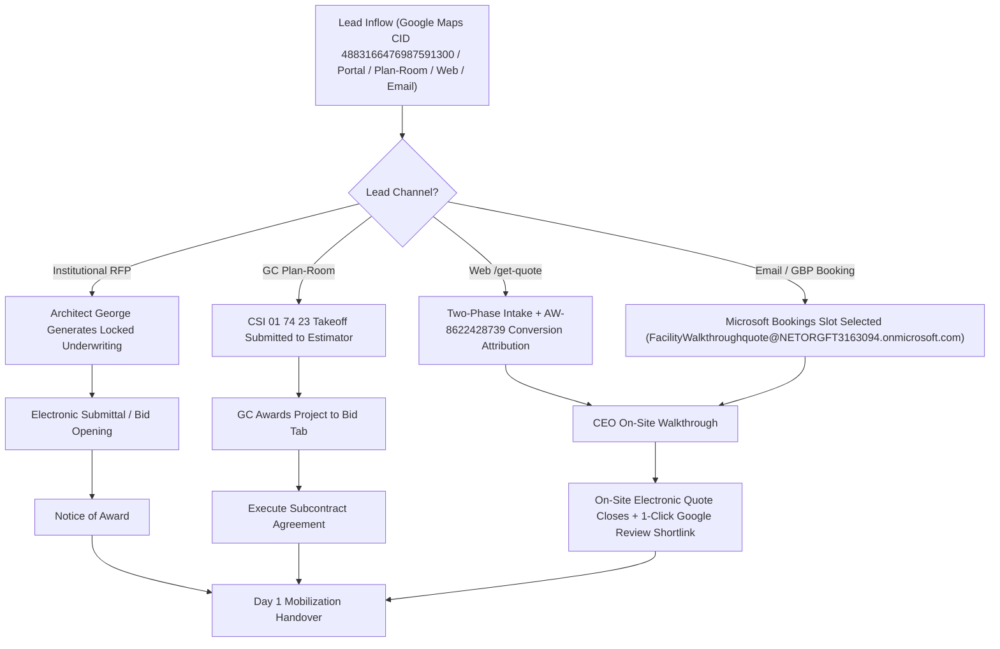

| **Document Control** |                                                                      |
| :------------------- | :------------------------------------------------------------------- |
| **Document Title**   | **Sales Process SOP with Contact-First Intake & Google Ecosystem Loop** |
| **Document ID**      | HWB-QMS-8.0                                                          |
| **Version**          | 4.1.0                                                                |
| **Status**           | APPROVED                                                             |
| **Author**           | George (Systems Architect & mbB)                                     |
| **Approved By**      | Humberto Dominguez, CEO                                              |
| **Date**             | 10/16/2026                                                           |
| **ISO 9001 Clause**  | 8.2.1 & 8.2.2 — ISO 9001:2026 (ISO 9001:2015+Amd 1:2024)             |

---

# Standard Operating Procedure: **Sales Process SOP**

## 1.0 Purpose
This SOP defines the standard process for managing commercial sales inquiries from first contact—via Google Maps Local Pack (`CID: 4883166476987591300`), Microsoft Bookings (`FacilityWalkthroughquote@NETORGFT3163094.onmicrosoft.com`), or `/get-quote`—to walkthrough assessment, proposal delivery, and post-quote Google Review collection.

## 2.0 Scope
Applies to all HWB staff and automated systems managing commercial leads, institutional RFPs, GC plan-room takeoffs, and customer onboarding in the PostgreSQL CRM.

## 3.0 Universal Mandates (2026 Baseline)
1. **Contact-First Intake:** Secure Name and Email/Phone within 10 seconds before requesting detailed building specs.
2. **Activity & Conversion Tracking:** Every lead status change is recorded in PostgreSQL, and web conversions fire CIPA/CPRA consent-gated attribution to GA4 (`G-8BX5Q7THYR`) and Google Ads (`862-242-8739` / `AW-8622428739`).
3. **Physical Truth:** Reference verified McKinney HQ (`3342 FM 1827 Ste 8d, McKinney, TX 75071`), E.164 phone `+1-214-586-0257`, and verified $2,000,000 commercial liability coverage (ACORD 25).

## 4.0 The Zero-Caller & Two-Phase Sales Sequence

### 4.1 Acquisition Channels (Asynchronous & Inbound Pull)
1. **Channel 1 (Institutional RFPs/RFBs):** Public procurement portals (NTTA, TxDOT, Counties, ISDs). Automated bid scraping and locked underwriting.
2. **Channel 2 (Commercial GC Plan-Rooms - CSI 01 74 23):** Plan invitations via BuildingConnected, Procore, and CivCast. Submits standardized takeoff proposals directly to GC estimators.
3. **Channel 3 (Automated Compliance Cadences):** Sector-specific email sequences (Lauri Tells Engine) targeting verified facility decision-makers with embedded Microsoft Bookings links (`https://bookings.cloud.microsoft/book/FacilityWalkthroughquote@NETORGFT3163094.onmicrosoft.com/`).
4. **Channel 4 (Google Maps Local Pack & Two-Phase Web Intake):** Prospects discovering HWB on Google Maps (`CID: 4883166476987591300`) or 11 DFW city pages complete the 10-second `/get-quote` form and optional 10-second pricing calibration card (`quote_success.html`).

### 4.2 Workflow

### 4.3 Procedural Steps
1. **Asynchronous Lead Capture:** System ingests portal solicitations, GC plan room invitations, Microsoft Bookings appointments, and `/get-quote` submissions into PostgreSQL (`"Leads"`).
2. **Two-Phase Pricing Calibration:** On `quote_success.html`, prospects optionally tap 1-touch City and Cleaning Schedule chips and enter approximate square footage (`POST /update-quote-details`), dispatching `pricing_calibrated` ($250.00) to GA4 and Google Ads (`AW-8622428739`).
3. **Self-Scheduled Walkthrough / Automated Takeoff:** Prospect selects a walkthrough window via Microsoft Bookings (`FacilityWalkthroughquote@NETORGFT3163094.onmicrosoft.com`), or estimator submits electronic plan takeoff.
4. **Conduct Assessment:** CEO Humberto Dominguez conducts in-person walkthrough, verifies cleanable square footage, and inspects flooring substrates.
5. **Deliver Proposal & Review Handshake:** Submit formal proposal within 2 hours using the SigmaFidelity™ pricing engine. Every confirmation card (`quote_success.html`) and executive email signature (`executive_signature.html`) includes the 1-Click Google Review modal shortlink (`https://g.page/r/CYTq8OcJfsRDEBM/review`).

## 5.0 Verification (Zero-Defect Check)
* Signed agreement is uploaded to the Account record.
* Client data in CRM matches the final service agreement.
* All Google Ads (`AW-8622428739`) and GA4 (`G-8BX5Q7THYR`) conversion events fire only after affirmative CIPA/CPRA consent.

## 6.0 Revision History
| Version | Date | Author | Change Description |
| :--- | :--- | :--- | :--- |
| 4.1.0 | 10/16/2026 | George | Integrated 5-Room Google Ecosystem into Sales Process (SO-COM-001-DIR-10B through DIR-10G): added Google Maps CID (4883166476987591300), Microsoft Bookings walkthrough endpoint, Google Ads Account ID 862-242-8739 (AW-8622428739) conversion attribution, and 1-Click Google Review shortlink (https://g.page/r/CYTq8OcJfsRDEBM/review). Approved by Humberto Dominguez, CEO. |
| 4.0.0 | 10/01/2026 | George | Replaced prototype slider widget with Contact-First 10-Second Intake and Two-Phase Pricing Calibration card. |
| 2.1.0 | 09/18/2026 | George | ZERO-CALLER PIVOT. Eliminated remote telemarketing and discovery call bottlenecks; formalized 4-Pillar Asynchronous Engine. |
| 2.0.0 | 05/21/2026 | George | TOTAL MODERNIZATION. Standardized ID to HWB-QMS-8.0 and added Tier 6 mandates. |
| 1.0 | 02/20/2026 | Gemini | Initial Release. |
